# Architecture diagrams (Milestone 3, Appendix A)

Milestone 3 says its Appendix A holds "the exact sources of every figure, stored in
docs/architecture/". Milestone 1 also commits to keeping the Mermaid.js files in the repository.
These `.mmd` files were recovered from the final Milestone 3 PDF (October 23, 2026), Appendix A.
Page headers and footers were removed, and lines the PDF wrapped were rejoined.

Every file renders with Mermaid CLI 11.4.2, and CI checks this on every push. Successful
rendering proves the syntax is valid. It does not prove that each rejoined line is word-for-word
the team's original file: please compare with the team's Mermaid files if they still exist.

The diagrams describe the design. Where the implementation differs (for example SQLAlchemy and
Tailwind in Diagram 1), see `../INTEGRATION_DECISIONS.md`.

### 01-container

Source: [`01-container.mmd`](01-container.mmd)

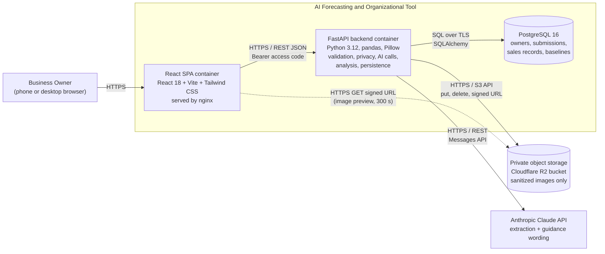

### 02a-class-capture

Source: [`02a-class-capture.mmd`](02a-class-capture.mmd)

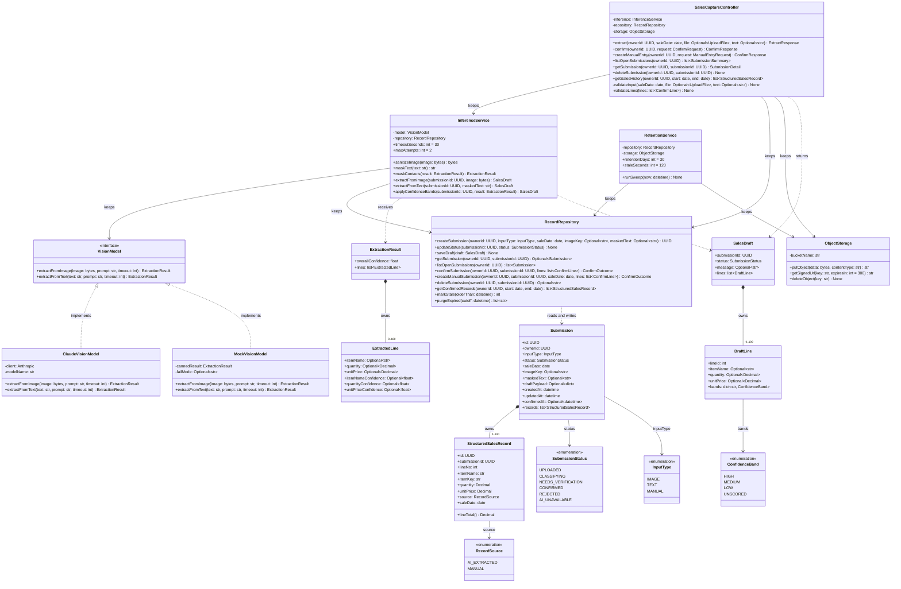

### 02b-class-analysis

Source: [`02b-class-analysis.mmd`](02b-class-analysis.mmd)

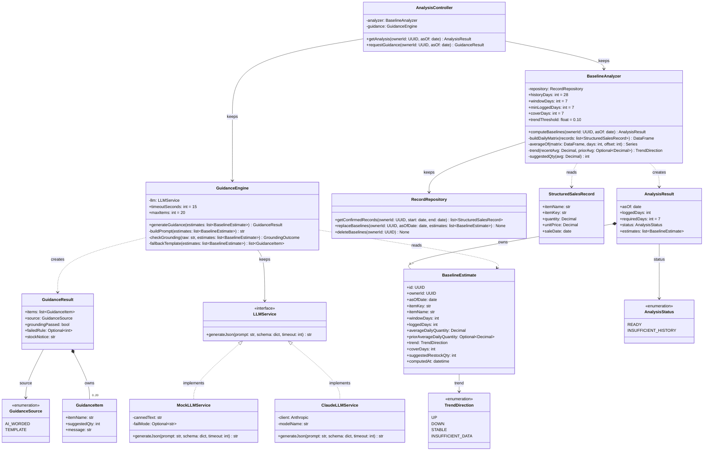

### 03-sd01-photo-extraction

Source: [`03-sd01-photo-extraction.mmd`](03-sd01-photo-extraction.mmd)

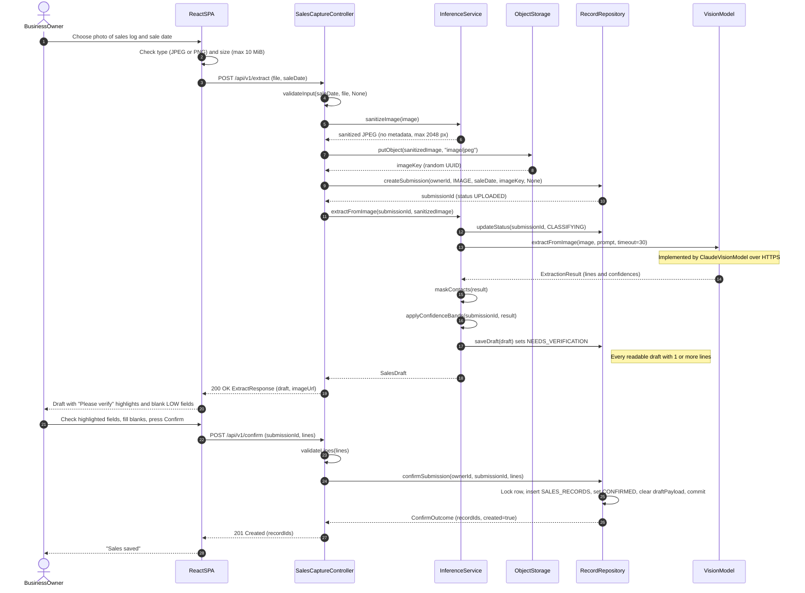

### 03-sd02-extraction-fallback

Source: [`03-sd02-extraction-fallback.mmd`](03-sd02-extraction-fallback.mmd)

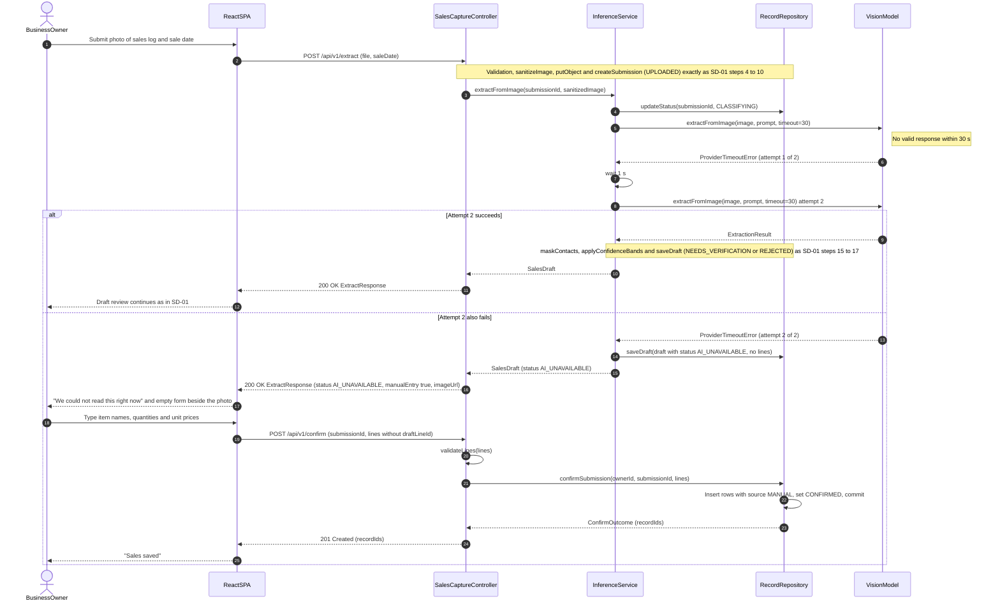

### 03-sd03-baseline-guidance

Source: [`03-sd03-baseline-guidance.mmd`](03-sd03-baseline-guidance.mmd)

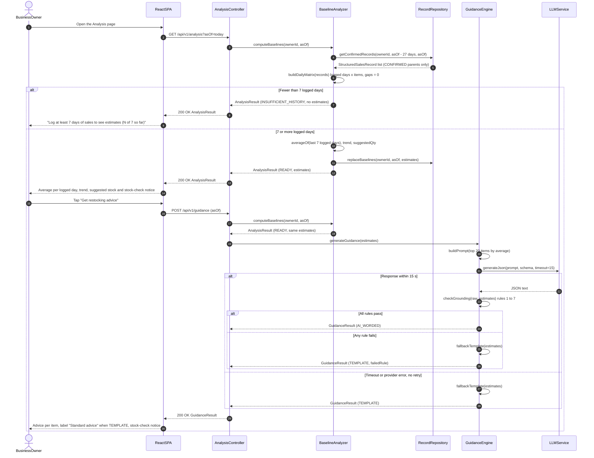

### 03-sd04-text-and-manual-entry

Source: [`03-sd04-text-and-manual-entry.mmd`](03-sd04-text-and-manual-entry.mmd)

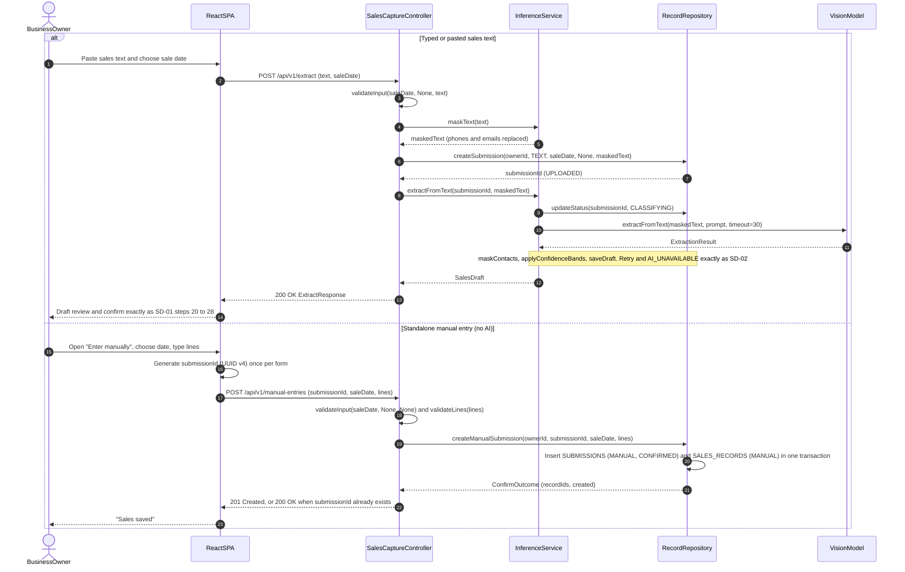

### 04-submission-state

Source: [`04-submission-state.mmd`](04-submission-state.mmd)

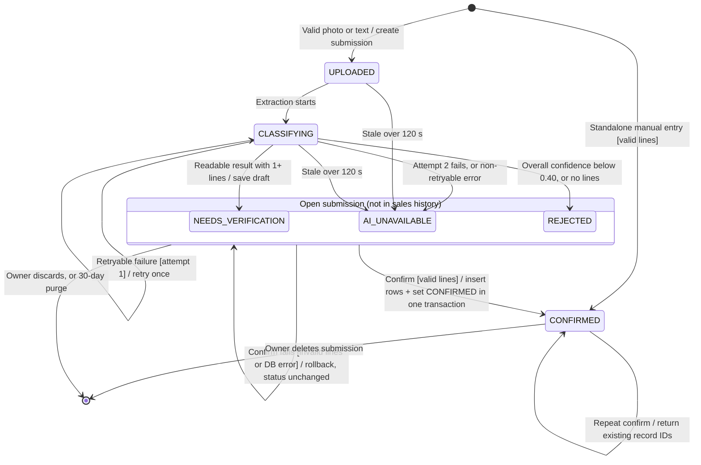

### 05-erd

Source: [`05-erd.mmd`](05-erd.mmd)

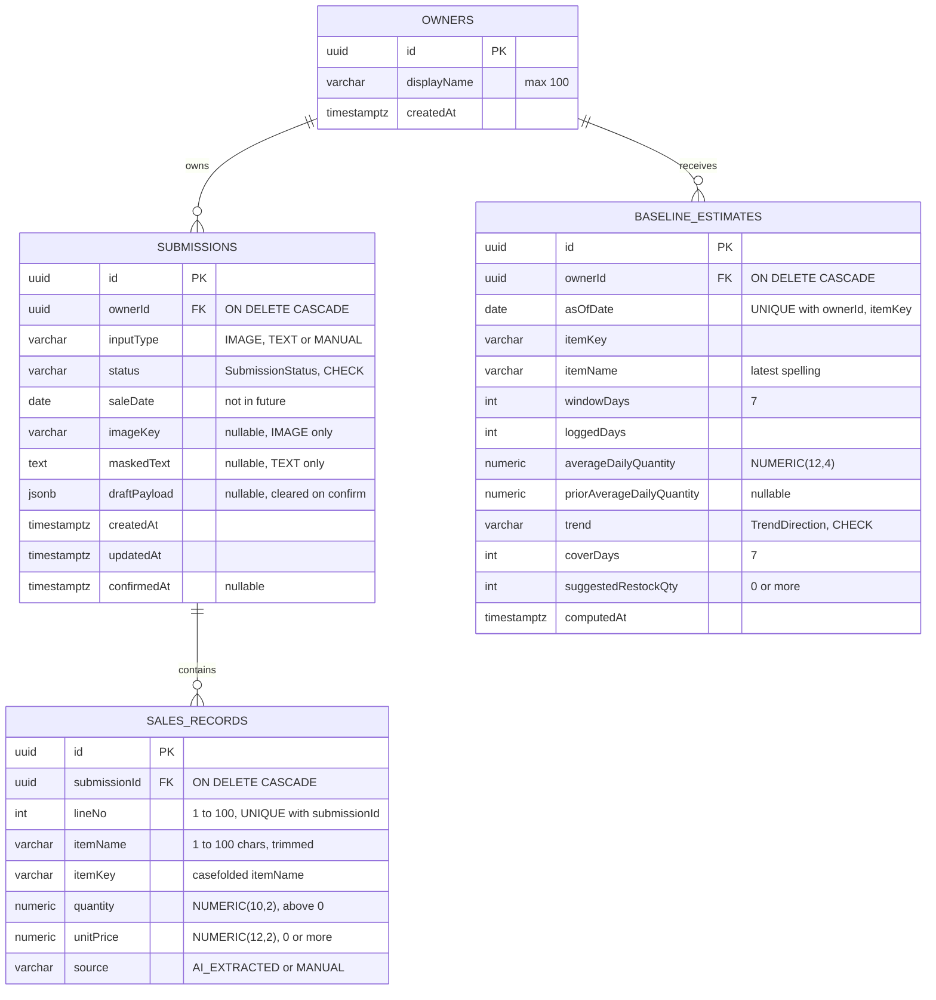

### 06-deployment

Source: [`06-deployment.mmd`](06-deployment.mmd)

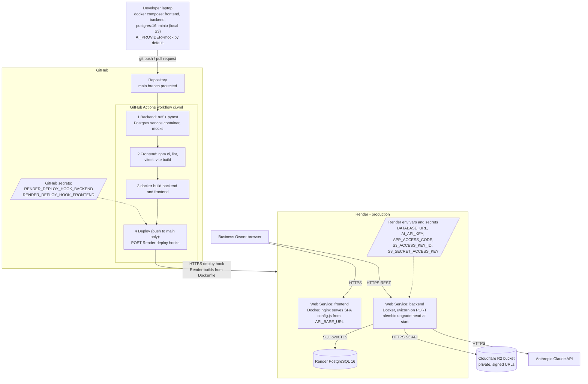

### 07-ai-pipeline

Source: [`07-ai-pipeline.mmd`](07-ai-pipeline.mmd)

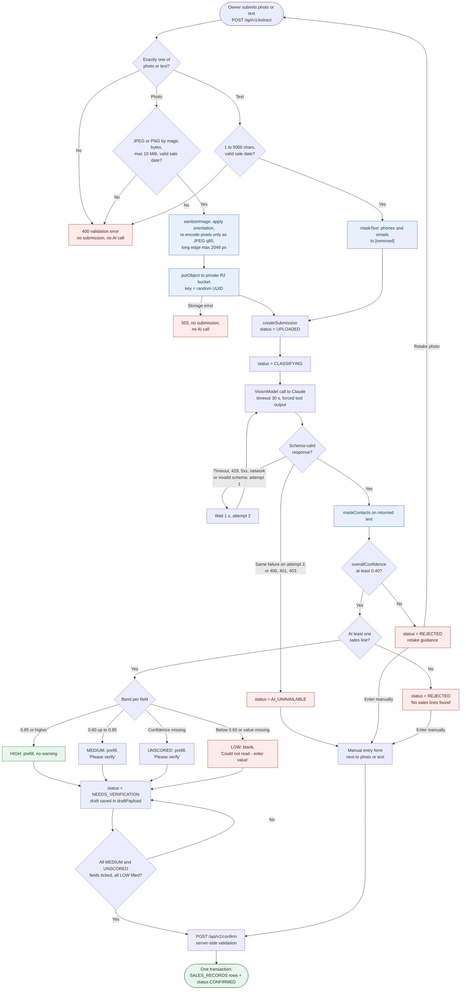
