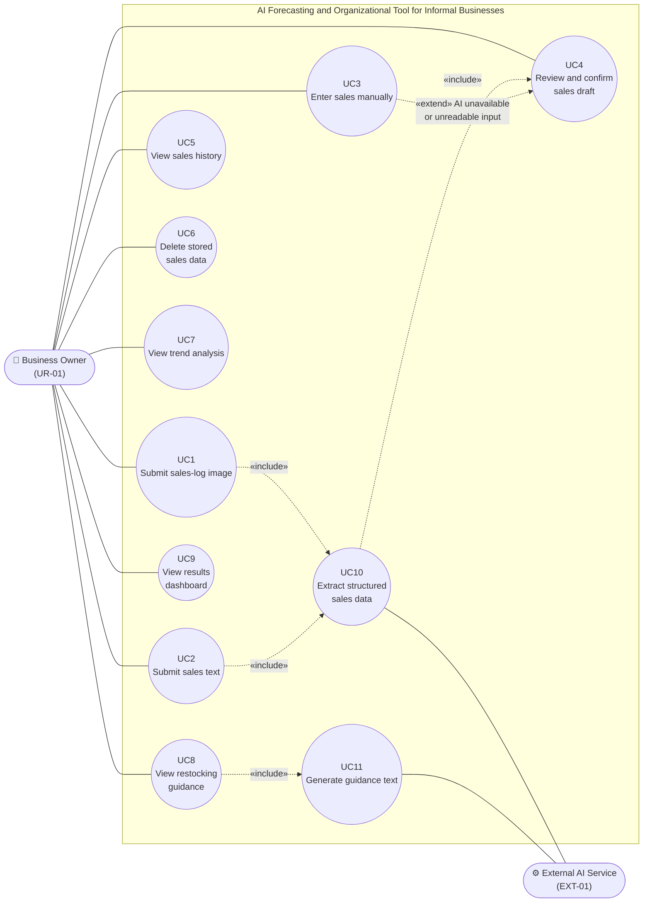
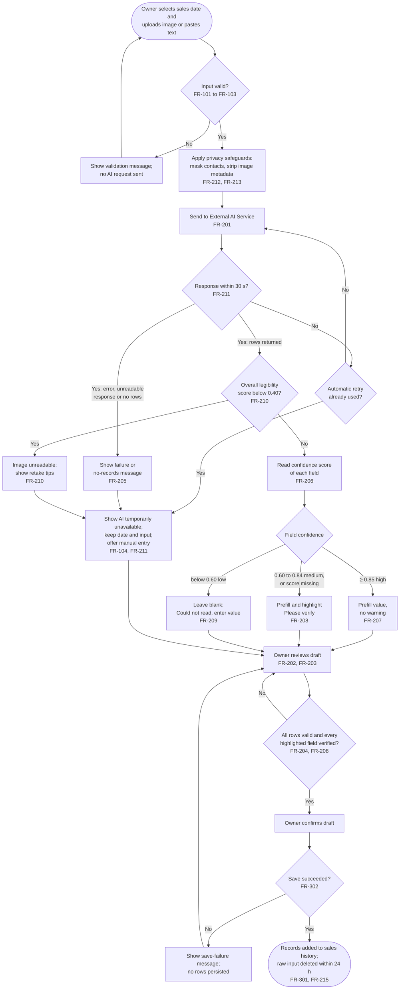
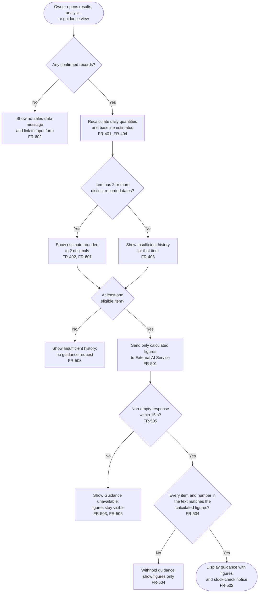

# Software Requirements Specification — diagrams (Milestone 2, section 6)

Milestone 2 section 6: "The same source is committed to the project repository in the GitHub
Markdown file docs/requirements/SRS.md, where GitHub renders it natively." This file holds that
source. It was recovered from `Milestone_2_final.docx` (version 2.0, baselined), with the
document's line breaks kept. The requirement text itself stays in the baselined document. Where
Milestone 3 section 3 changes a requirement, see `../TRACEABILITY.md`.

Every diagram renders with Mermaid CLI 11.4.2; CI checks this on every push.

### 01-use-case

Source: [`01-use-case.mmd`](01-use-case.mmd)

### 02-user-journey

Source: [`02-user-journey.mmd`](02-user-journey.mmd)

### 03-ai-fallback

Source: [`03-ai-fallback.mmd`](03-ai-fallback.mmd)

